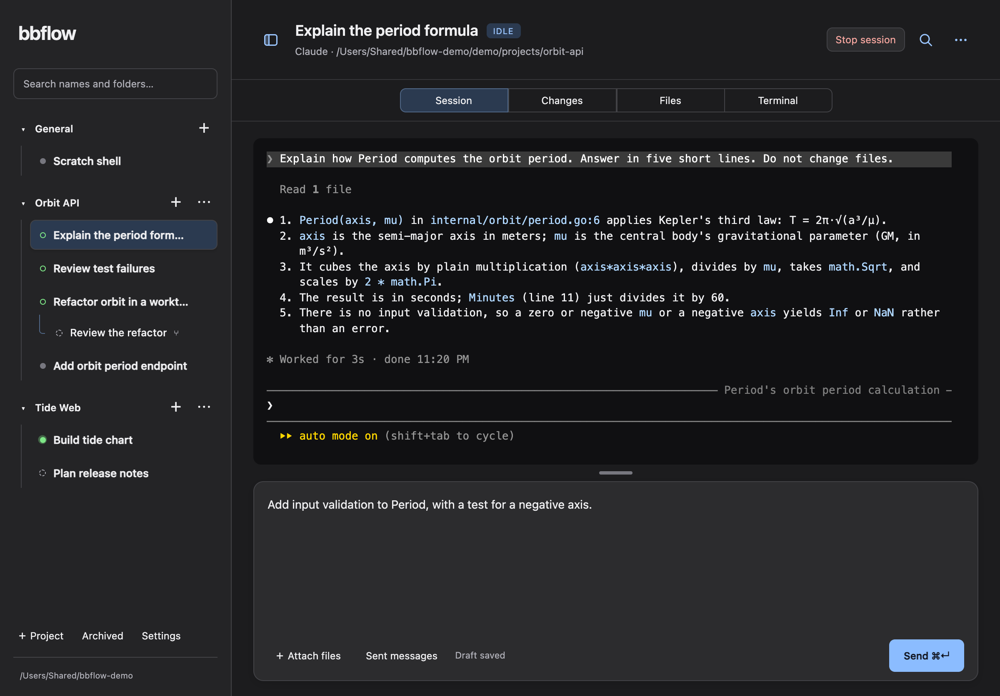

# bbflow

<picture>
  <source media="(prefers-color-scheme: dark)" srcset="docs/images/bbflow-dark.svg">
  
</picture>

bbflow runs the agent command-line interface (CLI) tools that you already use, such as
Codex and Claude Code, in one browser workspace. Sessions continue after you close the
tab. bbflow records each session, so you can search it or continue it with a different
agent.



## What you can do

- **Use the agents that you have.** A tool is a normal CLI command. It keeps its own
  sign-in, options, and permissions.
- **Keep sessions in operation.** Close the tab or the browser. The session continues
  in a background server.
- **Find earlier work.** bbflow records the input and output of each session. Search
  one session, one project, or all sessions.
- **Change agents during a task.** After a session ends, continue it in a new terminal
  with a different tool. A handoff prompt points the new agent to the earlier work.
- **Keep tasks apart.** Start a session in its own Git worktree.
- **Work from your phone.** Open the web UI on another device through
  [Tailscale Serve](docs/REMOTE.md).

## Install on macOS

```sh
curl -fsSL https://github.com/gyson/bbflow/releases/latest/download/install.sh | sh
```

The installer puts `bbflow` in `~/.local/bin`. It supports Apple Silicon and Intel, and
it needs no other tools. If that directory is not on your PATH, add
`export PATH="$HOME/.local/bin:$PATH"` to your shell configuration.

## Get started

1. Start the server and open the web UI.

   ```sh
   bbflow server start
   bbflow ui
   ```

2. Click **Settings**. Add a tool with a name and a startup command, for example
   **Codex** with `codex`. The agent CLI must be on PATH and signed in.
3. Click **＋ Project** to add a folder.
4. Click **＋** beside the project. Select the tool. Then click **Start session**.

See the [user guide](docs/GUIDE.md) for each step in detail, for the handoff between
agents, and for tips.

## Update

```sh
bbflow update
```

An update keeps your history and settings. It restarts the server, and that ends active
sessions. bbflow asks for confirmation first. The web UI also shows a newer release
above **Settings** in the sidebar. See [Update bbflow](docs/COMMANDS.md#update-bbflow).

bbflow is at an early version. Commands and APIs can still change.

## Privacy

- bbflow keeps its data on your computer. It has no telemetry and no cloud storage.
  Each agent CLI still sends data to its own provider.
- The recording includes all terminal input and output, including secrets that you
  type. bbflow does not redact or encrypt it.
- The server asks GitHub for the latest release when it starts and then once a day. The
  request sends no history or settings. Turn it off with **Check for a new version
  every day** in Settings.

See [Your data](docs/GUIDE.md#your-data) for the storage location and the limits.

## Documentation

| Document | Contents |
| --- | --- |
| [User guide](docs/GUIDE.md) | How to use the web UI, step by step. |
| [Commands](docs/COMMANDS.md) | Each `bbflow` command, its options, and its effects. |
| [Remote access](docs/REMOTE.md) | Setup of access from another device, such as a phone. |
| [Release notes](docs/releases/) | The changes in each release. |

For contributors: [DEVELOPMENT.md](docs/DEVELOPMENT.md) has the build and check
procedures, and [AGENTS.md](AGENTS.md) has the rules. [SPEC.md](docs/SPEC.md) and
[PROTOCOL.md](docs/PROTOCOL.md) describe the implementation. [GOAL.md](docs/GOAL.md)
and [PLAN.md](docs/PLAN.md) describe the direction.

## License

bbflow is licensed under the [MIT License](LICENSE).
