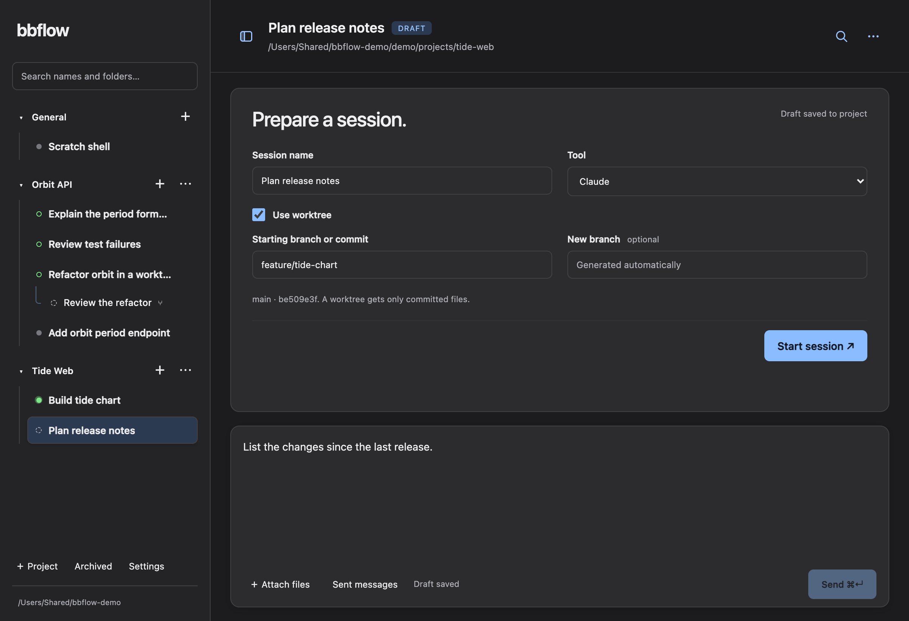

# bbflow user guide

This guide tells you how to use the bbflow web UI, from the first start to a handoff
between agents. See [README.md](../README.md) for installation. See
[COMMANDS.md](COMMANDS.md) for each `bbflow` command. See [SPEC.md](SPEC.md) for the
exact rules and the limits.

## Start the server

```sh
bbflow server start
bbflow ui
```

- `bbflow server start` starts a background server. The server continues after the
  terminal closes.
- On macOS, the server adds a menu bar icon with **Open UI** and **Quit bbflow**. Quit
  bbflow stops the server and its sessions.
- `bbflow ui` opens the home page in the default browser.

Each session uses the environment of the server. After you change PATH or the
environment, restart the server from a shell that has the new values.

## Add your tools

A tool is an agent command-line interface (CLI) that bbflow can start, such as Codex or
Claude Code.

1. Install the CLI of the agent on PATH.
2. Sign in to the agent in a terminal, as you do without bbflow.
3. In bbflow, click **Settings** at the bottom of the sidebar.
4. Give the tool a name and a startup command, for example **Codex** with `codex`.

**Shell** is always available. It starts the shell without a command.

## Add a project

A project is a folder that you save in the sidebar. A new session of a project starts
in that folder.

1. Click **＋ Project** at the bottom of the sidebar.
2. Select an existing folder.

**General** is always available for work across projects.

## Start a session



1. Click **＋** beside a project to create a draft.
2. Select a tool.
3. To give the session independent files, select **Use worktree**.
4. Click **Start session**.

You can write the first message in the editor below the form before you start. bbflow
saves the message as a draft. Click **Send** after the agent is ready.

## Work in a session

- Type in the terminal. As an alternative, write a message in the editor below the
  terminal and click **Send**.
- Close the tab when you want. The session and its recording continue in the server.
- Click **Stop session** to end the session.

## Continue with a different agent

Use this procedure after a session ends, for example when an agent reaches a quota
limit.

1. Click **Continue in new terminal**.
2. Select the tool for the new terminal. bbflow writes a read-only handoff folder with
   the earlier terminals and messages.
3. Wait until the new agent is ready.
4. Click **Handoff prompt** in the message editor, and send the prompt.

The prompt gives the new agent a record of the earlier work. It does not restore the
internal state of the earlier agent.

## Search the history

Click the search icon to search the recorded output of a session, a project, or all
sessions.

`bbflow query` reads the history with read-only SQL. An agent can run `bbflow skill` to
learn these queries. See [COMMANDS.md](COMMANDS.md).

## Use bbflow from another device

Remote access from another device, such as a phone, is off by default. It works through
Tailscale Serve. See [Remote access with Tailscale Serve](REMOTE.md) for the setup.

## Tips

- **Keep the full output.** Run agents in the normal screen to keep their full output
  in the handoff transcript. For Codex, use `codex --no-alt-screen`. For Claude Code,
  keep the fullscreen renderer off.
- **Share a tool set.** To share a tool set with a team, write a setup script with
  `bbflow tool add` and `bbflow settings set`. See
  [Manage tools](COMMANDS.md#manage-tools).

## Your data

See [Privacy](../README.md#privacy) in the README for what bbflow records and sends.

- The installed release keeps all durable bbflow data in `~/.bbflow/history.sqlite`.
  Workspace files and agent credentials stay outside this database.
- The server listens only on loopback, `127.0.0.1` and `::1`, and uses no
  authentication token. It does not protect the data from other processes that run as
  you.
- Backup and restore are not available. A copy of `history.sqlite` alone can miss
  committed data while the server runs.
- The server upgrades the database automatically when it starts. See
  [database upgrades](SPEC.md#database-upgrades).

See [Data handling](SPEC.md#data-handling) for the exact rules.
